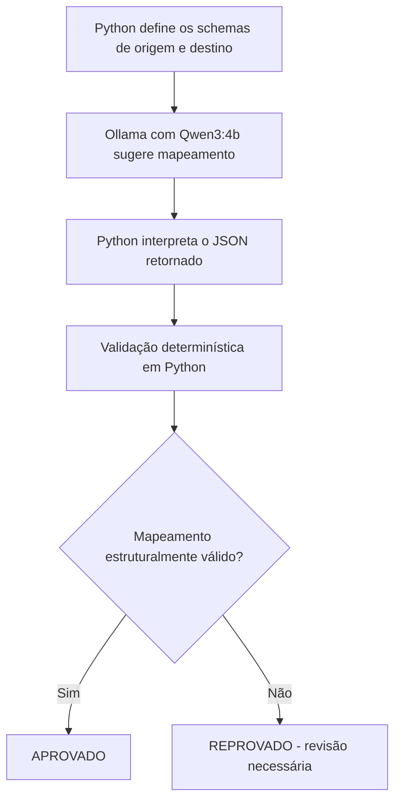

# AI Data Ingestion Agent

### POC de ingestão de dados assistida por Inteligência Artificial

> **Status atual:** primeira etapa funcional da POC — sugestão e validação estrutural de mapeamentos de schemas. A ingestão efetiva de arquivos ainda não foi implementada.

## 1. Visão geral

Este projeto é uma **Prova de Conceito (POC)** voltada à aplicação de Inteligência Artificial em processos de engenharia de dados.

O objetivo é explorar como modelos de linguagem (LLMs) podem auxiliar na **identificação e no mapeamento de colunas** entre diferentes estruturas de dados, reduzindo o esforço manual necessário para integrar novas fontes.

Por exemplo, duas fontes podem utilizar nomes diferentes para o mesmo conceito, como `ID_CLIENTE` e `customer_id`. Um LLM pode sugerir essa correspondência, mas sua sugestão precisa ser verificada antes de ser utilizada em um processo de dados.

Nesta primeira etapa, a solução utiliza **Python** e um modelo de linguagem executado localmente pelo **Ollama**, com as seguintes funcionalidades:

- Solicitar a um LLM sugestões de mapeamento entre colunas de origem e destino.
- Receber a sugestão de mapeamento em formato JSON.
- Validar o resultado com regras determinísticas implementadas em Python.
- Identificar inconsistências antes de utilizar o mapeamento em etapas posteriores.
- Executar testes automatizados de validação com `pytest`.

**Importante:** a ingestão efetiva de arquivos, o armazenamento e as transformações de dados fazem parte das próximas fases. O projeto ainda **não implementa um agente autônomo**; o nome do repositório reflete a direção de evolução pretendida.

## 2. Arquitetura técnica

A arquitetura **atualmente implementada** é composta por três elementos:

1. **Python:** define os schemas de origem e destino, envia requisições ao modelo e controla a execução.
2. **Ollama + Qwen3:4b:** disponibiliza um modelo de linguagem local que sugere correspondências entre colunas, retornando JSON.
3. **Validação determinística:** o módulo `src/validators.py` verifica se o mapeamento gerado atende às regras estruturais estabelecidas.

### Fluxo de processamento



O processo segue estas etapas:

1. O Python define as colunas de origem e destino.
2. O prompt é enviado ao Qwen por meio da API local do Ollama.
3. O modelo retorna uma sugestão de mapeamento em JSON.
4. O Python converte a resposta em um dicionário.
5. O módulo de validação verifica as regras estabelecidas.
6. O processo retorna o status **APROVADO** ou **REPROVADO**.

As validações documentadas incluem:

- Existência das colunas de origem.
- Existência das colunas de destino.
- Identificação de destinos duplicados.
- Identificação de colunas de origem não mapeadas.

Quando o mapeamento não atende às regras, ele é reprovado e o processo é interrompido.

**Decisão de projeto:** a aprovação não é delegada ao LLM. O modelo propõe correspondências, enquanto as regras implementadas em Python determinam a aprovação ou reprovação. Essas regras verificam aspectos estruturais; **não garantem que todas as correspondências sejam semanticamente corretas**.

## 3. Exemplo de funcionamento

Nesta primeira etapa, os schemas são definidos diretamente no código Python, sem leitura de arquivos CSV.

### Schema de origem

```text
ID_CLIENTE, DT, ITEM, QTD, PRECO_UN
```

### Schema de destino

```text
customer_id, sale_date, product, quantity, unit_price
```

### Exemplo de mapeamento sugerido pelo LLM

```json
{
  "ID_CLIENTE": "customer_id",
  "DT": "sale_date",
  "ITEM": "product",
  "QTD": "quantity",
  "PRECO_UN": "unit_price"
}
```

### Cenário 1 — Mapeamento aprovado

Quando todas as correspondências atendem às regras de validação, o processo apresenta:

```text
STATUS FINAL: APROVADO
Mapeamento liberado para a próxima etapa.
```

O processo termina com código de saída `0`.

### Cenário 2 — Mapeamento reprovado

Durante os testes, foi simulada uma correspondência inválida:

```text
ID_CLIENTE → customer_name
```

Como `customer_name` não existe no schema de destino, a validação identifica a inconsistência:

```text
ERRO: Destino inexistente: 'customer_name'

STATUS FINAL: REPROVADO
Mapeamento bloqueado para revisão.
```

Nesse cenário, o script utiliza `sys.exit(1)` para sinalizar a falha e interromper a execução.

> **Limite desta etapa:** os schemas ainda são definidos no código. A leitura e a ingestão efetiva de arquivos CSV serão implementadas futuramente.

## 4. Testes automatizados

O projeto utiliza `pytest` para verificar o comportamento das funções de validação.

Foram documentados seis testes:

| Teste | Objetivo |
|---|---|
| `test_validar_coluna_origem` | Verificar a existência de colunas de origem |
| `test_validar_coluna_destino` | Verificar a existência de colunas de destino |
| `test_validar_destino_duplicado` | Identificar destinos já utilizados |
| `test_identificar_colunas_nao_mapeadas` | Identificar colunas de origem sem correspondência |
| `test_validar_mapeamento_completo` | Aprovar um mapeamento estruturalmente válido |
| `test_validar_mapeamento_invalido` | Identificar um destino inexistente |

### Como executar os testes

Na raiz do projeto, com o ambiente virtual ativo:

```powershell
python -m pytest tests/test_validators.py -v
```

Durante o desenvolvimento, os seis testes foram executados com sucesso:

```text
collected 6 items

test_validar_coluna_origem PASSED
test_validar_coluna_destino PASSED
test_validar_destino_duplicado PASSED
test_identificar_colunas_nao_mapeadas PASSED
test_validar_mapeamento_completo PASSED
test_validar_mapeamento_invalido PASSED
```

Esse resultado é um **registro dos testes realizados durante o desenvolvimento**, não uma indicação de execução automática a cada atualização do repositório. Os testes verificam regras e cenários específicos; sua aprovação não representa cobertura completa do código nem garante a correção semântica de todas as sugestões do LLM.

## 5. Como executar o projeto

### Pré-requisitos

Para reproduzir o ambiente de desenvolvimento utilizado nesta POC:

- Python 3.11 (versão utilizada: 3.11.7).
- Git.
- Ollama instalado e em execução.
- Modelo `qwen3:4b` disponível localmente.

As instruções abaixo utilizam **Windows e PowerShell**, ambiente empregado no desenvolvimento.

### 5.1. Clonar o repositório

```powershell
git clone https://github.com/marcel1303/ai-data-ingestion-agent.git
cd ai-data-ingestion-agent
```

### 5.2. Criar e ativar o ambiente virtual

```powershell
python -m venv .venv
.\.venv\Scripts\Activate.ps1
```

### 5.3. Instalar as dependências Python

```powershell
python -m pip install -r requirements.txt
```

### 5.4. Preparar o modelo de linguagem

Com o Ollama instalado, baixe o modelo utilizado na POC:

```powershell
ollama pull qwen3:4b
```

Certifique-se de que o serviço local do Ollama esteja em execução. A aplicação utiliza o endpoint:

```text
http://localhost:11434/api/generate
```

### 5.5. Executar o mapeamento assistido por IA

Na raiz do projeto:

```powershell
python src/test_ollama.py
```

O script envia os schemas ao Qwen, recebe a sugestão de mapeamento em JSON e executa as regras de validação. Quando o resultado atende às regras, apresenta:

```text
STATUS FINAL: APROVADO
Mapeamento liberado para a próxima etapa.
```

### 5.6. Executar os testes automatizados

```powershell
python -m pytest tests/test_validators.py -v
```

Os testes de validação podem ser executados sem consultar o Ollama, pois verificam diretamente as funções de validação.

## 6. Roadmap de evolução

O desenvolvimento segue etapas incrementais, priorizando aprendizado prático, testabilidade e qualidade dos dados. Os itens abaixo identificam o que foi desenvolvido e o que ainda está planejado.

### Etapa 1 — Mapeamento de schemas assistido por IA

**Status: implementado**

- [x] Integração com Ollama e Qwen3:4b.
- [x] Geração de sugestões de mapeamento em JSON.
- [x] Validação de colunas de origem e destino.
- [x] Identificação de destinos duplicados.
- [x] Identificação de colunas não mapeadas.
- [x] Testes automatizados com `pytest`.

### Etapa 2 — Ingestão de arquivos CSV

**Status: planejado**

- [ ] Leitura de arquivos CSV reais.
- [ ] Extração automática das colunas de origem.
- [ ] Validação de tipos de dados.
- [ ] Aplicação dos mapeamentos aprovados.
- [ ] Tratamento de inconsistências nos registros.

### Etapa 3 — Armazenamento com AWS S3

**Status: planejado**

- [ ] Configuração do armazenamento.
- [ ] Organização dos arquivos de origem.
- [ ] Persistência dos arquivos processados.
- [ ] Definição de estratégias de rastreabilidade.

### Etapa 4 — Integração com Snowflake

**Status: planejado**

- [ ] Configuração do ambiente analítico.
- [ ] Criação das estruturas de destino.
- [ ] Carga dos dados validados.
- [ ] Verificação de integridade após a carga.

### Etapa 5 — Transformações com dbt

**Status: planejado**

- [ ] Criação dos modelos de transformação.
- [ ] Padronização dos dados.
- [ ] Implementação de testes de qualidade.
- [ ] Documentação dos modelos analíticos.

### Etapa 6 — Visualização e observabilidade

**Status: planejado**

- [ ] Criação de um dashboard analítico.
- [ ] Acompanhamento das execuções.
- [ ] Monitoramento de erros e rejeições.
- [ ] Análise da qualidade dos dados processados.

## 7. Limitações atuais

Esta versão representa a primeira etapa funcional de uma POC de ingestão assistida por IA. As principais limitações são:

- Os schemas são definidos diretamente no código.
- Ainda não existe ingestão efetiva de arquivos CSV.
- As validações atuais verificam a integridade estrutural, mas não garantem a correção semântica do mapeamento.
- Ainda não há validação de tipos de dados dos registros.
- O fluxo depende da disponibilidade local do Ollama.
- Ainda não existe integração com AWS S3, Snowflake ou dbt.
- O projeto ainda não implementa um agente autônomo.
- A resposta do LLM ainda não possui tratamento específico para falhas de conexão, timeout ou JSON inválido.

As próximas etapas buscarão evoluir a solução de forma incremental, mantendo a separação entre **sugestões produzidas pelo LLM** e **validações determinísticas de qualidade**.